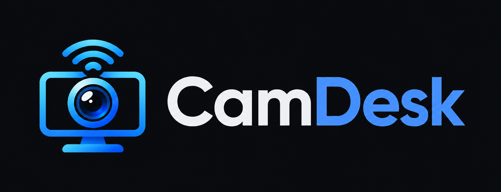
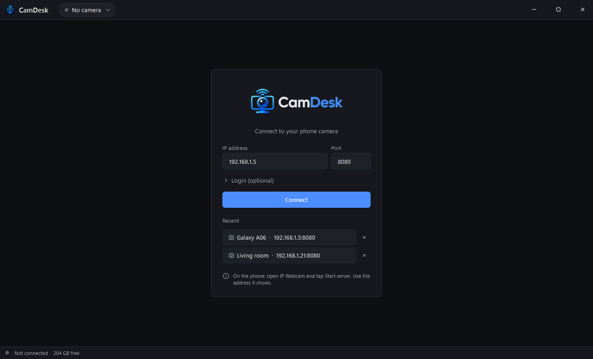
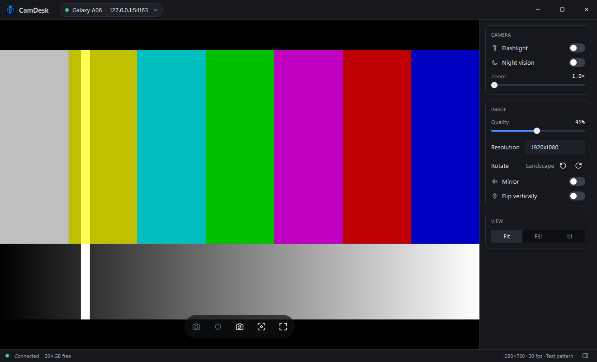
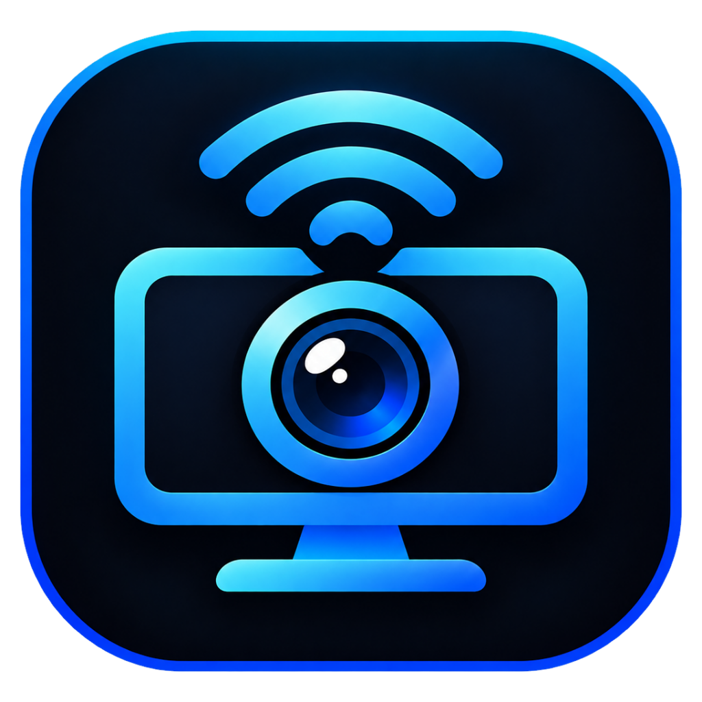

<p align="center">
  
</p>

<p align="center">
  <b>View, record and control your Android phone camera from Windows — smooth, GPU-accelerated and private.</b>
</p>

<p align="center">
  
  
  
  
</p>

# CamDesk

A smooth, modern Windows desktop app to view, record and control an Android phone running the **IP Webcam** app over Wi-Fi.

> **Status: in development.** Version 1, build steps **1–7 of 10** done: dark UI, live GPU-decoded video, and every
> camera control (flashlight, zoom, rotate, mirror, tap-to-focus, quality, resolution). Snapshots and recording are next. See [progress](docs/README.md#project-status).

<p align="center">
  
  <br><br>
  
  <br>
  <sub>Connect screen, and the main window streaming the built-in test pattern (<code>--fake</code>) with the <code>Ctrl+D</code> debug overlay.</sub>
</p>

## Highlights

- **Smooth, low-CPU video:** H.264 decoded on the GPU (D3D11VA) and converted to RGB in an OpenGL shader.
  Measured on a Galaxy A06 → MX230 laptop: **1080p @ 30 FPS, ~2% CPU, 0 dropped frames**.
- **Never lags behind:** only the newest frame is kept, so delay can't build up.
- **Self-healing connection:** automatic reconnect with backoff, plus an MJPEG fallback stream.
- **Recording without re-encoding** (coming in step 8): H.264 + AAC saved straight to crash-safe MKV.
- **Private:** no telemetry; talks only to your phone on the local network. Passwords live in Windows Credential Manager.

## Requirements

- Windows 10/11
- [uv](https://docs.astral.sh/uv/): `winget install astral-sh.uv` (open a new terminal afterwards)
- Python 3.12 (uv installs it automatically if missing)
- An Android phone with [IP Webcam](https://play.google.com/store/apps/details?id=com.pas.webcam) on the same network. In the app, tap **Start server**.

## Quick start

```powershell
git clone https://github.com/DilshanRanabahu/camdesk.git
cd camdesk
uv sync                                         # install dependencies
uv run python -m camdesk                        # opens the connect screen; enter the IP shown in IP Webcam
uv run python -m camdesk --host 192.168.x.x     # or connect straight away (the camera is remembered)
uv run python -m camdesk --fake                 # no phone? built-in test pattern
```

Paste the address exactly as IP Webcam shows it (e.g. `http://192.168.1.5:8080`); CamDesk picks out the IP and port.
If the custom title bar ever misbehaves, `--native-frame` uses the standard Windows one.

| Key | Action |
|---|---|
| `Ctrl+D` | Debug overlay: FPS, CPU, decoder, bitrate, frame age |
| `F11` / `F` / double-click | Fullscreen (`Esc` exits) |
| `V` | View mode: fit / fill / original size |
| `Tab` | Show / hide the side panel |
| `T` / `C` / `N` / `A` | Flashlight / switch camera / night vision / focus |
| Click the picture | Focus on that spot |
| `+` / `-` | Zoom in / out |
| `Ctrl+R` | Retry the connection |

**Picture sideways or upside down?** Use **Rotate** in the side panel. It rotates on the phone, so recordings come out right too.

Recommended phone settings (resolution, Samsung battery settings, static IP): [docs/decisions.md § 4](docs/decisions.md#4-recommended-phone-setup-ip-webcam).

## Development

```powershell
uv run pytest            # 188 tests: no phone needed (fake camera + fake video + real OpenGL render checks)
uv run ruff check .      # lint
uv run ruff format .     # format
```

- Architecture, threads and folder layout: [docs/architecture.md](docs/architecture.md)
- Rules for AI coding agents: [AGENTS.md](AGENTS.md)
- All docs: [docs/README.md](docs/README.md)

## Tech stack

Python 3.12 · PySide6-Essentials (Qt 6) · PyAV (FFmpeg) · OpenGL shaders · httpx · keyring · uv · pytest · ruff

## Logo



The app icon is a camera lens on a desktop monitor with a Wi-Fi signal, in CamDesk's dark theme with the `#4C8DFF` accent.
Files are in [`src/camdesk/resources/`](src/camdesk/resources/): `icon.png` (1024 px, transparent), `app.ico` (16–256 px, used for the window and taskbar) and `wordmark.png`.
To regenerate them from new source images, run `uv run python scripts/make_icons.py <icon.png> <wordmark.png>`.

<br clear="left">

## Where CamDesk stores data

| Data | Location |
|---|---|
| Settings and logs | `%APPDATA%\CamDesk\` |
| Snapshots and recordings | `%USERPROFILE%\Videos\CamDesk\` |
| Camera passwords | Windows Credential Manager |
